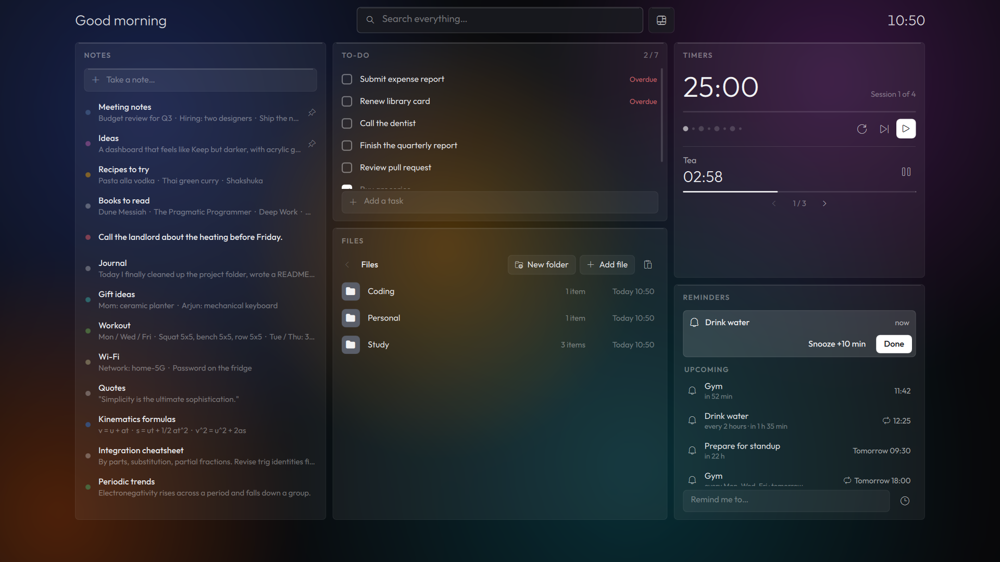
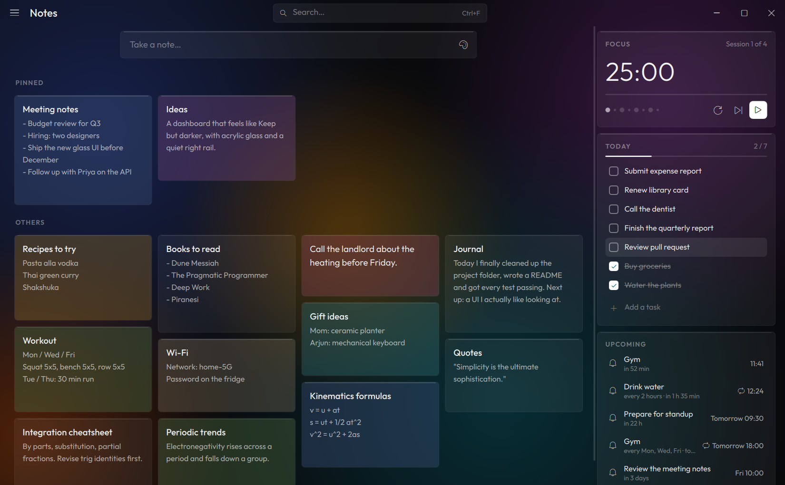
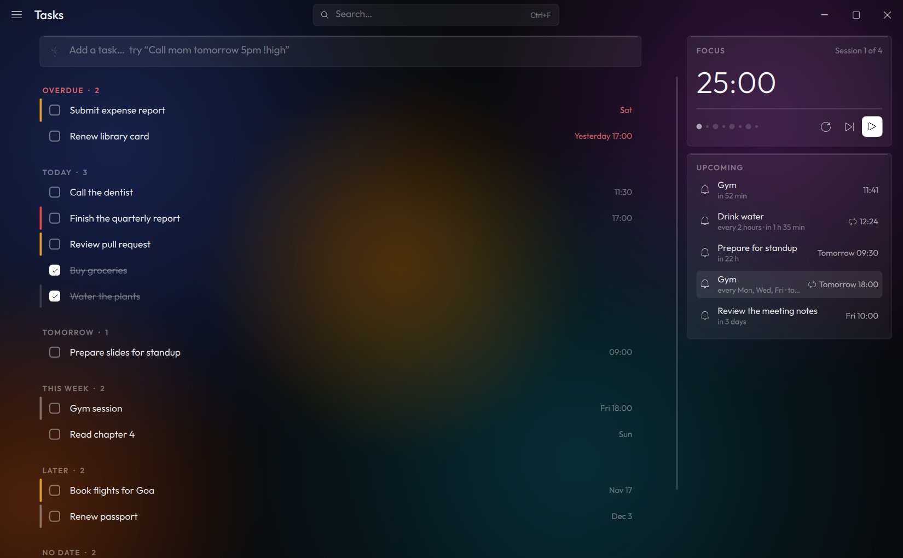
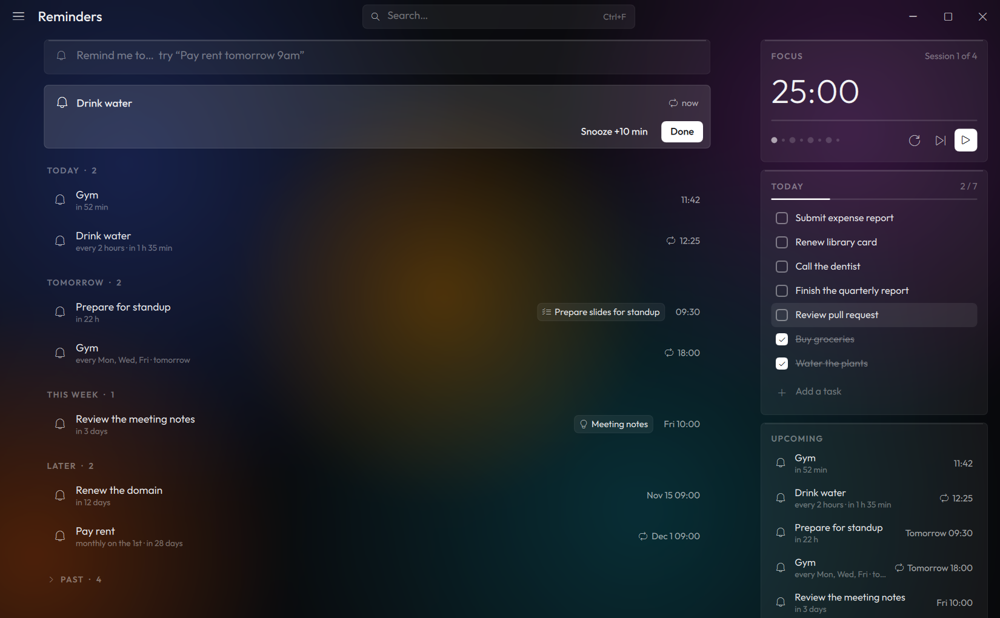
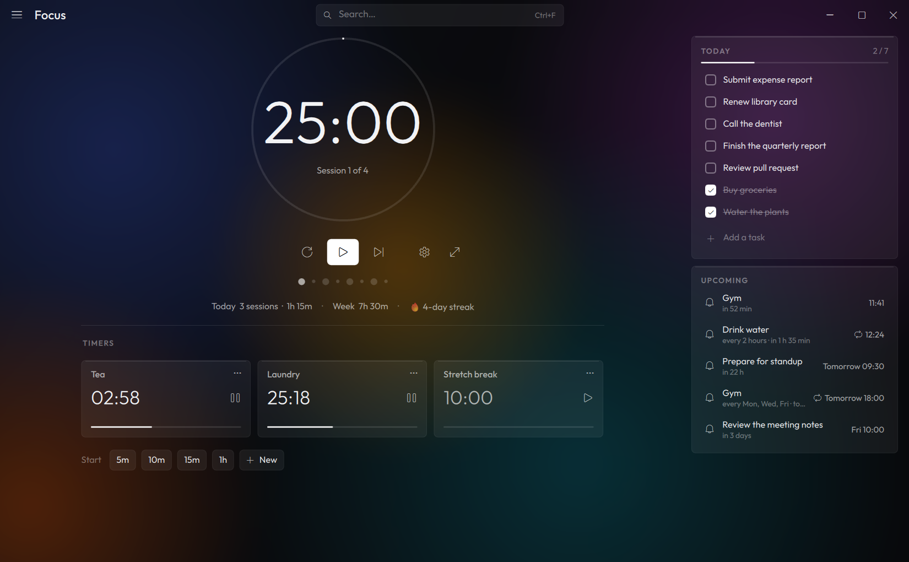
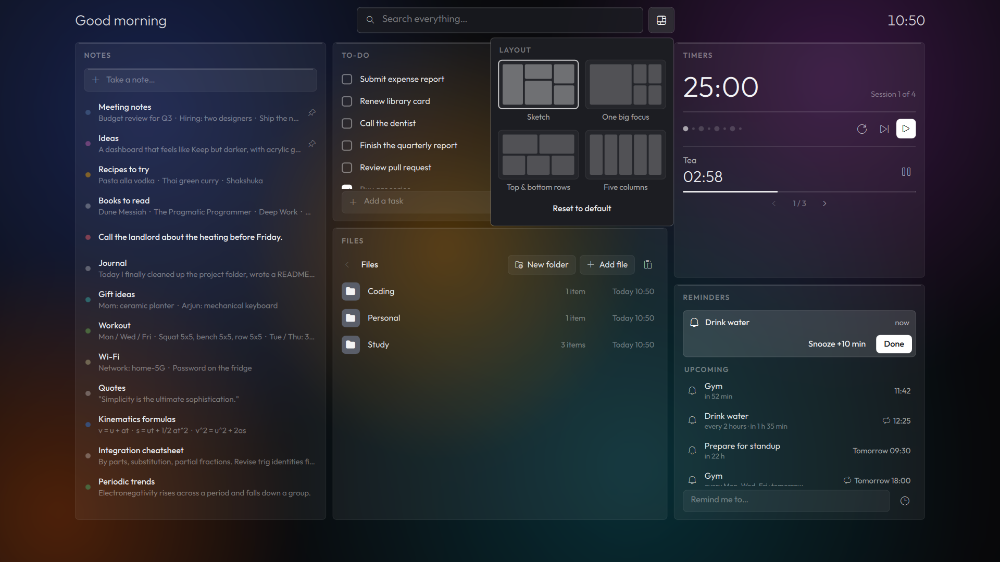

# Panelo

A local-first productivity app for Windows: notes, tasks, repeating reminders, timers and focus
sessions, a files library, full-text search, trash with a 30-day purge, and automatic
backup/restore. It is a PySide6 (Qt Quick) desktop app with a system tray icon, a global hotkey
and single-instance activation. All data is stored in a local SQLite database; files live in a
plain folder on disk.

The UI has two modes:
- **Quick overlay:** opened with a global hotkey (default Ctrl+Alt+Space). Five rearrangeable
  glass panels (Notes, To-Do, Files, Timers, Reminders) float over a blurred snapshot of the
  screen.
- **Full App:** a Keep-style notes grid plus pages for Tasks, Reminders, Focus, Files, Trash and
  Settings, over a blurred copy of the desktop wallpaper. Double-click an overlay panel header to
  morph the overlay into the Full App.

## Screenshots

**Quick overlay** (Ctrl+Alt+Space)



**Full App: notes**



| Tasks | Reminders |
|---|---|
|  |  |
| **Focus and timers** | **Overlay layouts** |
|  |  |

<sub>Screenshots show sample data from the built-in self-test.</sub>

## Download and install

1. **Download the installer.** Go to the
   [latest release](https://github.com/Shaurya-289/panelo/releases/latest) and download
   `Panelo-Setup-1.0.0.exe`.
   The repository is private, so you must be signed in to GitHub with an account that has access.
   With the [GitHub CLI](https://cli.github.com/) you can also run:
   ```powershell
   gh release download v1.0.0 -R Shaurya-289/panelo
   ```
   (`SHA256SUMS.txt` in the release lists the checksum of each file.)
2. **Run it.** If Windows shows *"Windows protected your PC"* (the installer is not signed), click
   **More info**, then **Run anyway**.
3. **Click through the setup.** It installs just for you, with no admin prompt, into
   `%LOCALAPPDATA%\Programs\Panelo`. It adds a Start Menu entry and, unless you untick it, a
   desktop shortcut.
4. **Start Panelo.** Leave *Launch Panelo* ticked on the last page, or open it from the Start Menu.

**Portable zip instead:** download `Panelo-1.0.0-portable.zip`, extract it anywhere and run
`Panelo\Panelo.exe`. Nothing is installed; it uses the same data folder as the installed app.

**Upgrading:** run the newer installer. It closes Panelo if it is running and keeps your data.

**Uninstalling:** open **Settings > Apps > Installed apps**, find **Panelo** and choose
**Uninstall**. This also removes the *Start with Windows* entry. Your data in
`%LOCALAPPDATA%\Panelo\Panelo` is kept; delete that folder if you want to erase it too.

**Requirements:** 64-bit Windows 10 (version 1809 or newer) or Windows 11. Windows 11 is
recommended, because the icons use the Segoe Fluent Icons font.

## Status

| Part | Status |
|---|---|
| Backend (database, services, migrations) | Done, tested |
| New Qt Quick UI | Done |
| UI connected to the backend | Done (bridge, scheduler, shell, `--selftest`) |
| Packaging / installer | Done (v1.0.0: Windows installer and portable zip) |

## Requirements

These are only needed to run Panelo from source or build the installer (the installer above
needs nothing else).

- Windows 10/11
- Python 3.12+
- [uv](https://docs.astral.sh/uv/)
- SQLite built with FTS5 (checked at startup)

## Running from source

1. **Install [uv](https://docs.astral.sh/uv/)** (it also installs the right Python for you).
   In PowerShell:
   ```powershell
   powershell -ExecutionPolicy ByPass -c "irm https://astral.sh/uv/install.ps1 | iex"
   ```
   Or, with winget:
   ```powershell
   winget install --id astral-sh.uv -e
   ```
   Then close and reopen PowerShell.
2. **Download the code:**
   ```powershell
   git clone https://github.com/Shaurya-289/panelo.git
   cd panelo
   ```
3. **Install the dependencies:**
   ```powershell
   uv sync
   ```
4. **Start the app:**
   ```powershell
   uv run python -m panelo.desktop
   ```

### Using it

- The first launch opens the Full App with a short welcome tour (it asks your name).
- The app keeps running in the **system tray** (bottom-right of the taskbar) when you close the
  window. Right-click the tray icon for *Open overlay*, *Open full app* and *Quit*.
- Press **Ctrl+Alt+Space** anywhere to open the quick overlay; press it again or Esc to close it.
  You can change the hotkey in Settings.
- **Double-click a panel header** in the overlay (or press the hotkey twice quickly) to expand it
  into the Full App.
- Everything is stored locally on your computer; nothing is sent anywhere.
- Turn on **Start with Windows** in Settings to have it waiting in the tray after you sign in.

## Run options

```powershell
# The app (a second launch just asks the running one to show itself)
uv run python -m panelo.desktop

# Start hidden in the tray (what "Start with Windows" uses); add --show to also open the window
uv run python -m panelo.desktop --startup

# Automated UI checks: opens real windows on screen, runs on a temporary database and library
uv run python -m panelo.desktop --selftest

# Backend only (initializes/migrates the database, then exits)
uv run python -m panelo
```

`--startup` is what the "Start with Windows" entry runs: it starts hidden in the tray unless
`--show` is also given. The first launch shows the welcome tour.

Data and logs live in per-user directories chosen by `platformdirs` (app name `Panelo`, e.g.
`%LOCALAPPDATA%\Panelo\Panelo`); the database file is `panelo.db`, the log `panelo.log`, and
backups are named `panelo-backup-*`. Panelo was previously called ProductivityApp: on first launch
it copies any existing data from `%LOCALAPPDATA%\ProductivityApp\ProductivityApp` automatically
(the old folder is left in place). The Files library defaults to a
`Files` folder in the data directory and can be moved in Settings.

## Building the installer

The packaging files are in [`packaging/`](packaging/): `panelo.spec` (PyInstaller),
`panelo.iss` (Inno Setup), `build.ps1` (the build script) and `panelo_launcher.py` (the exe's
entry point).

1. **Install uv and Inno Setup 6:**
   ```powershell
   winget install --id astral-sh.uv -e
   winget install --id JRSoftware.InnoSetup -e
   ```
   Then close and reopen PowerShell.
2. **Install the dependencies** (in the `panelo` folder):
   ```powershell
   uv sync
   ```
3. **Build:**
   ```powershell
   powershell -ExecutionPolicy Bypass -File packaging\build.ps1 -Selftest
   ```
   It runs the lint and tests, builds the app, runs the self-test on the built exe, and writes:
   - `dist\Panelo\` (the app folder)
   - `dist\Panelo-<version>-portable.zip`
   - `dist\Panelo-Setup-<version>.exe`
   - `dist\SHA256SUMS.txt`

   Other switches: `-SkipChecks` (skip lint and tests) and `-SkipInstaller` (no Inno Setup step).

The version comes from `pyproject.toml`. Keep `__version__` in `src/panelo/__init__.py` the same
(a test checks this).

To run the self-test on the built exe by hand:

```powershell
$env:PANELO_SELFTEST_OUTPUT="$PWD\selftest.log"; (Start-Process dist\Panelo\Panelo.exe --selftest -Wait -PassThru).ExitCode
```

Without `PANELO_SELFTEST_OUTPUT`, the report goes to `%TEMP%\panelo-selftest.log`.

## Development and testing

```powershell
uv run pytest                  # all tests, with coverage (Qt runs offscreen)
uv run pytest tests/ui         # just the UI bridge tests
uv run ruff check .            # lint
uv run mypy                    # strict type checking
$env:QT_FORCE_STDERR_LOGGING = "1"; uv run python -m panelo.desktop --selftest
```

Tests use temporary databases and never touch the real data directory, registry Run key or
Recycle Bin. `--selftest` takes a few minutes and should finish with every check passing and no
QML warnings on stderr. Set `PANELO_SELFTEST_OUTPUT` to a file path to write the self-test report
to that file instead of the console.

## Layout (`src/panelo/`)

| Package | Role |
|---|---|
| `core/` | Clock, config, event bus, exceptions, ids, lifecycle, logging, paths, recurrence rules |
| `db/` | Engine/session, unit of work, ORM models, Alembic migrations |
| `repositories/` | Data access per feature |
| `schemas/` | Pydantic input/output types |
| `services/` | Business logic and validation |
| `bootstrap.py` | Composition root; safe runtime replacement (e.g. after restore) |
| `files/` | Files library on disk (path guard, name clashes, moves), no database |
| `ui/` | The Qt Quick UI: `qml/` (App module), `fonts/`, `bridge/` (Python `Backend`, scheduler, library adapter, system helpers), `selftest/` |
| `desktop/` | Process shell: entry point, overlay/Full App controller, tray, hotkey, single-instance IPC, startup registration |
| `windows/` | Windows adapters: mutex, hotkeys, startup registry, window presentation |

## Design specs

The design decisions for each UI round are in [`docs/design/`](docs/design/). The plan for
turning the prototype into this app is [`docs/PLAN-real-app.md`](docs/PLAN-real-app.md). The
original prototype remains in git history (commit `acdedab`).

## Migrations

Migrations run automatically at startup. To work on them with the Alembic CLI, set
`sqlalchemy.url` explicitly (see `alembic.ini`).
